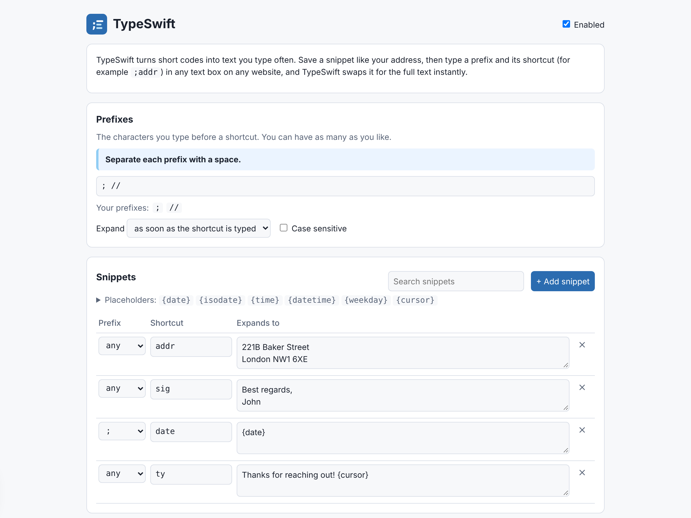
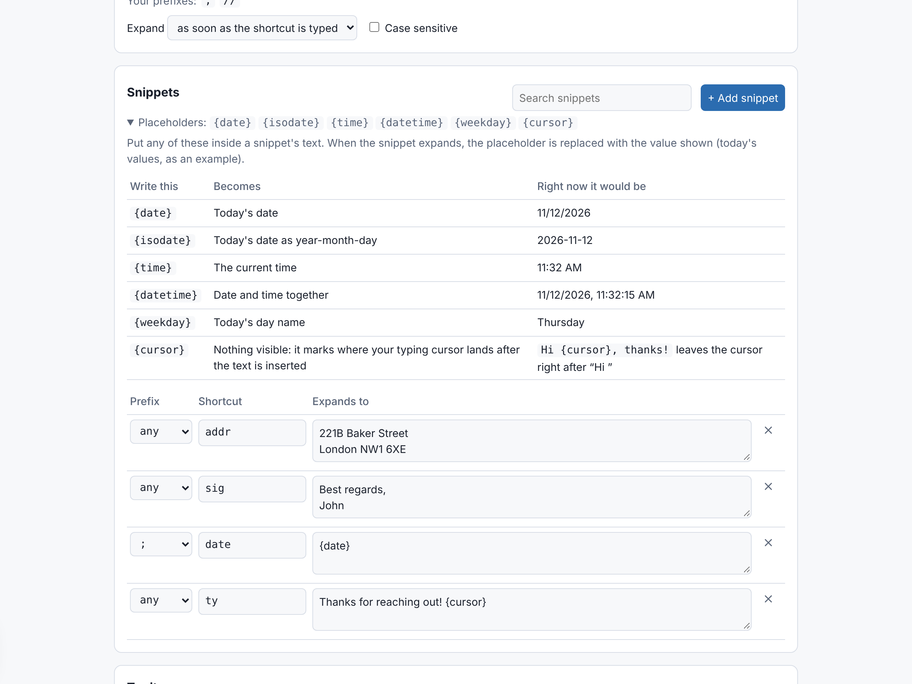
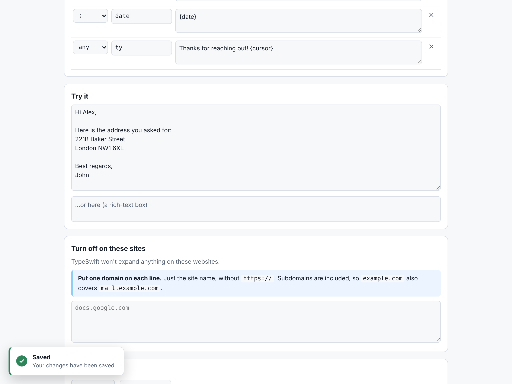

  

<h1 align="center">TypeSwift</h1>

<strong>A text expander for Firefox.</strong>

---

TypeSwift turns short codes into the text you type over and over. Save a snippet like your address or email signature, then type a prefix and its shortcut, such as `;addr`, in any text box on any website. TypeSwift instantly replaces it with the full text.

## Features

- **Your own prefixes.** Use any symbols you like to start a shortcut, such as `;`, `//` or `!!`, and as many as you want. Each snippet can work with all of your prefixes or only one.
- **Works almost everywhere.** Plain text fields, comment boxes, and rich editors like Gmail, Slack and Notion.
- **Two ways to expand.** Expand the moment a shortcut is typed, or only after you press Space or Enter.
- **Placeholders.** Add `{date}`, `{time}`, `{datetime}`, `{weekday}` or `{isodate}` to a snippet to fill in the current value, and `{cursor}` to choose where your cursor lands after the text is inserted.
- **Per-site control.** Turn TypeSwift off for a site from the toolbar button, or keep a list of sites where it should never run.
- **Undo friendly.** Press Ctrl+Z right after an expansion to get your shortcut back.
- **Backup.** Export your snippets to a file and import them on another computer.
- **Try it in place.** The settings page has a test box, so you can check a snippet before using it.

## How it works

1. Open TypeSwift's settings from the toolbar button.
2. Pick your prefixes, separated by spaces.
3. Add a snippet: a short name, and the text it should become.
4. Type a prefix and the short name in any text box, and it expands.

## Privacy

TypeSwift collects nothing. Your snippets and settings are stored only in your own Firefox profile and never leave your computer. The extension makes no network requests and never touches password fields.

## Requirements

Firefox 115 or newer on desktop.

## License

MIT. See [LICENSE](LICENSE).
